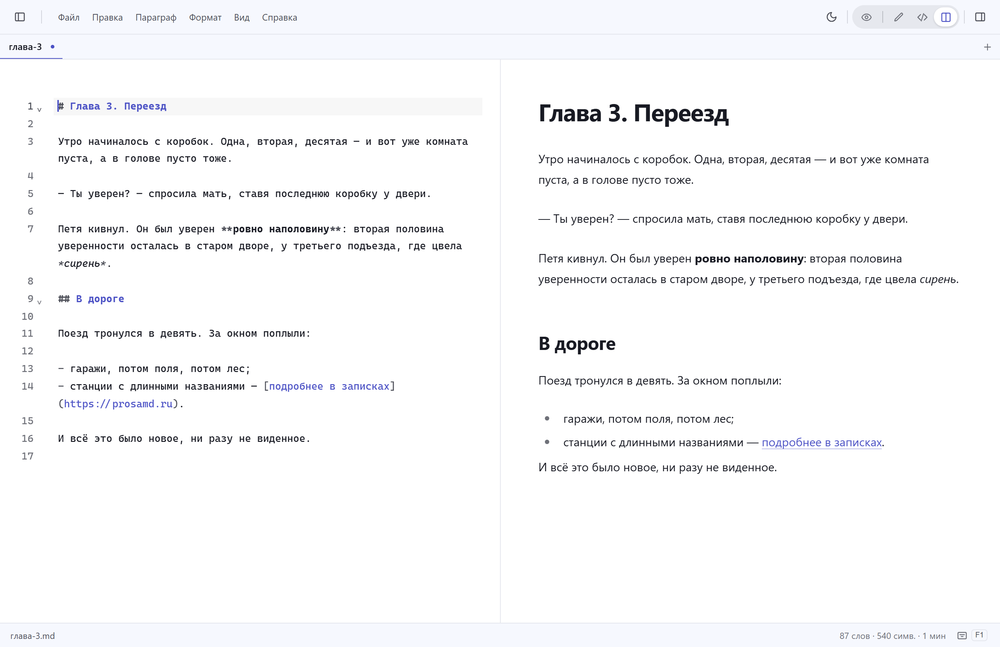
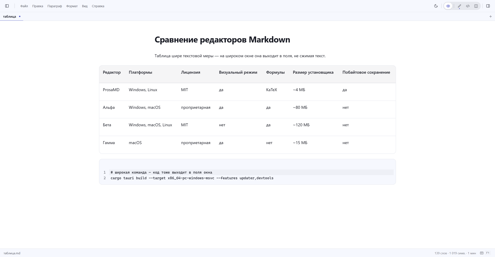

**English** · [Русский](README.ru.md)

<p align="center">
  <picture>
    <source media="(prefers-color-scheme: dark)" srcset="kit/prosamd-horizontal-white.svg">
    
  </picture>
</p>

### A minimal open-source Markdown editor & viewer — a "notepad" for `.md` files.

Open a file, read or edit, save. No vaults and no databases — just your `.md` files on disk,
kept byte-exact even through the visual editor. Light and fast: Tauri 2 instead of Electron,
a ~4 MB installer, no accounts, clouds or telemetry.

<p align="center">
  <a href="https://github.com/Wad-man/prosa/actions/workflows/ci.yml"></a>
  <a href="https://github.com/Wad-man/prosa/releases/latest"></a>
  <a href="https://tauri.app"></a>
  <a href="LICENSE"></a>
</p>


Dark theme:


**[Download the latest version](https://github.com/Wad-man/prosa/releases/latest)** · [prosamd.ru](https://prosamd.ru)

If ProsaMD is your kind of notepad, a ⭐ helps other people find it.

## Contents

- [What makes ProsaMD different](#what-makes-prosamd-different)
- [Install](#install)
- [Features](#features)
- [Keyboard shortcuts](#keyboard-shortcuts)
- [Building from source](#building-from-source)
- [Updates](#updates)
- [Architecture](#architecture)
- [Roadmap](#roadmap)
- [Contributing and licenses](#contributing-and-licenses)

## What makes ProsaMD different

- **Like a notepad**: open a file → read or edit → save. No vaults and no databases — just your `.md` files on disk.
- **Byte-exact saving (lossless round-trip)**: open → save → the file is unchanged. Since 0.1.10 this holds for the visual editor too: front-matter, tables and exotic syntax are never rewritten.
- **Four modes** in one switcher (`Alt+1`…`Alt+4`; `Ctrl+/` flips Reading ↔ editing):
  - **Reading** — the document as an article: no cursor or editing, links and footnotes take a plain click, notes are collected at the bottom;
  - **Visual editor** — Markdown rendered as you type: the whole document looks finished right away. Showing a block's source syntax under the cursor (as Typora does) is on the roadmap;
  - **Code** — a classic text editor with Markdown and code-block highlighting (CodeMirror 6);
  - **Split** — the code and the live preview side by side, scrolling together.
- **Light and fast**: the installer is around 4 MB, startup is quick — Tauri 2 instead of Electron.
- **No accounts, no subscriptions**: no sign-ups, clouds or telemetry. Free and open (MIT).



## Install

Download the latest version from [Releases](https://github.com/Wad-man/prosa/releases) or [prosamd.ru](https://prosamd.ru).

| Platform | How |
| --- | --- |
| **Windows** 10/11 x64 | Run `ProsaMD_<version>_x64-setup.exe` (~4 MB installer) or use the portable `*-portable-x64.exe` (~8 MB). The installer is not signed yet, so SmartScreen may warn: **More info → Run anyway**. |
| **Linux** x64 / ARM64 | Ubuntu/Debian: `sudo apt install ./ProsaMD_*_amd64.deb` (ARM64 — `*_arm64.deb`); it adds the launcher icon and `.md` associations. Other distros: make the `*.AppImage` executable and run it. |
| **macOS** | A separate downstream version: [Wad-man/prosa-mac](https://github.com/Wad-man/prosa-mac). |
| **iOS / Android** | Planned for v0.4. |

## Features

- Open / save / save as, drag a `.md` file into the window; the Open dialog and Explorer take a multi-selection — every file becomes a document in one window
- **The tab strip** (v0.3): a window's open files as tabs under the toolbar — a press switches, drag reorders, × closes, the + button and a double-press on empty space create a document; dozens of open files are fine: tabs shrink, the strip scrolls with the wheel
- **The open-files list** (`Ctrl+Shift+2`): the left column with all documents of the window — switch, close, "close all" from the context menu, drag the edge to resize; unsaved changes (including several dirty documents at once) ask to confirm
- **Recent files**: up to ten in the File menu, a press opens
- **The menu bar**: File, Edit, Paragraph, Format, View, Help (mouse or `Alt+F/E/P/O/V/H`) — formatting commands in both editing modes, checkmarks of the current state
- **Document outline** (`Ctrl+Shift+1` or the top-right button): heading navigation in every mode, the current section highlighted
- **Find & replace** (`Ctrl+F` / `Ctrl+H`) in every mode: highlighted matches, a counter, Enter/F3 jumps, match case; the Code mode gets CodeMirror's own panel with regular expressions
- **Print & PDF** (`Ctrl+P` / `Ctrl+Shift+P`): the real print dialog; "Save as PDF" writes a clean A4 document without headers and footers
- Several windows at once: every file can be its own window (reopening an open file focuses its window) — or many documents in one window
- Unsaved-changes indicator, word and character counts; closing a window with edits asks to save
- The About dialog — click the version in the status bar
- Light/dark theme (follows the system by default); interface RU / EN (Settings, `Ctrl+,`)
- Footnotes the Obsidian way: press a marker to jump to the note, the number to come back; Reading collects the notes at the bottom
- Obsidian callouts: `> [!note]`, `> [!warning]`, `> [!tip]` and more render with per-type styling
- "Copy for Word" (Edit menu): formatting survives into Word, Google Docs and mail
- Images by relative paths from the document's folder; pasting from the clipboard saves the file next to the document and inserts a relative link
- Update check and install from inside the app; the automatic check can be turned off in Settings — off means no network requests at all
- Wide tables and code blocks bleed into the window margins — no empty gutters on wide screens
- GFM tables, checklists, code highlighting, formulas (KaTeX) — out of the box in the visual mode; diagrams (Mermaid) are planned as a plugin



### Keyboard shortcuts

| Keys | Action |
|---|---|
| `Ctrl+N` | New document (asks about unsaved edits) |
| `Ctrl+O` | Open file(s) |
| `Ctrl+S` / `Ctrl+Shift+S` | Save / Save as |
| `Alt+1`…`Alt+4` | Reading / Visual editor / Code / Split |
| `Ctrl+/` | Flip Reading ↔ editing |
| `Ctrl+F` / `Ctrl+H` | Find / replace |
| `Ctrl+P` / `Ctrl+Shift+P` | Print / Save as PDF |
| `Ctrl+Shift+1` | Show/hide the outline |
| `Ctrl+Shift+2` | Show/hide the open-files list |
| `Ctrl+,` | Settings |
| `RMB` | Formatting panel: with a selection — bold/italic/code/link, with the cursor in a block — change the block type |
| `Ctrl+1`…`Ctrl+6` / `Ctrl+0` | Heading 1–6 / plain text (also `Ctrl+Alt+1…6`, `Ctrl+Alt+0`) |
| `Ctrl+Alt+7` / `Ctrl+Alt+8` | Ordered / bullet list |
| `Ctrl+Alt+C` / `Ctrl+Shift+B` | Code block / quote |
| `Ctrl+B` / `Ctrl+I` / `Ctrl+E` / `Ctrl+K` | Bold / italic / inline code / link |

In the visual mode, markdown shortcuts work as you type: `# ` — heading, `- ` — list, `> ` — quote, ``` — code block, `**bold**`, `*italic*`; `/` at the start of an empty line opens the block-insert menu.

## Building from source

Requirements: [Node.js](https://nodejs.org) 20+, [Rust](https://rustup.rs) (stable, MSVC on Windows), on Windows — VS Build Tools with the "C++" workload.

```bash
npm install
npm run tauri dev      # run in dev mode
npm run tauri build    # release build (Windows: exe + NSIS installer)
```

Ready-made builds — in [this repository's releases](https://github.com/Wad-man/prosa/releases).

## Updates

ProsaMD checks for updates on launch (quietly, in the background); the automatic check can be turned off in Settings. A manual check lives in the About dialog (click the version in the status bar's bottom-right corner).
Installing means downloading the package, verifying its signature and restarting; administrator rights are not needed (per-user install).
The portable build (a bare `exe` without the installer) has no auto-update — download a new version by hand.

Releases and their signatures are published in [this repository's releases](https://github.com/Wad-man/prosa/releases)
(before the source code went public — in a separate, now archived [Wad-man/prosa-releases](https://github.com/Wad-man/prosa-releases)).

## Architecture

```
Core (TypeScript, shared code for all platforms)
├─ Visual mode — Milkdown (Crepe) on ProseMirror + remark
├─ Source mode — CodeMirror 6
└─ Native shell — Tauri 2 (Rust): files, dialogs, windows
```

## Roadmap

- [x] v0.1.0 — Windows: 2 modes, open/save, themes, RU/EN
- [x] v0.1.7 — right-click formatting panel, Crepe RU/EN localization, duplicate hotkeys (as in Typora)
- [x] v0.1.9 — menu bar, outline, typography; clipboard and hotkeys in both modes
- [x] v0.1.10 "Lossless core" — byte-exact saving from the visual mode (#33), Reading mode (#66), Obsidian footnotes (#64), "Copy for Word" (#63), relative-path images (#68)
- [x] v0.2.0 "Epigraph" — Windows + Linux (x64/ARM64), settings, print/PDF, find & replace, Raw HTML, zoom, hotkey panel, What's New; macOS — a separate version in [prosa-mac](https://github.com/Wad-man/prosa-mac)
- [x] v0.3.0 "Spread" — files: several documents in one window, the tab strip and the open-files list, recent files, Obsidian callouts, wide tables and code (#11, #97); the folder tree — in v0.4 (#92)
- [ ] v0.4 — plugins and themes from the community: the API platform + a catalog (#17, #18), the folder tree (#92), iOS / Android (#26)
- [ ] v0.5 — UI languages, top-10 — through the plugin platform (#22)
- [ ] Export: print/PDF — in the core (done in v0.2); DOCX/HTML/epub — a first-party plugin after the plugin platform (v0.4)

## Contributing and licenses

The project is open under the [MIT](LICENSE) license. Built on [Tauri](https://tauri.app),
[Milkdown](https://milkdown.dev), [CodeMirror](https://codemirror.net) — thanks to their authors.
