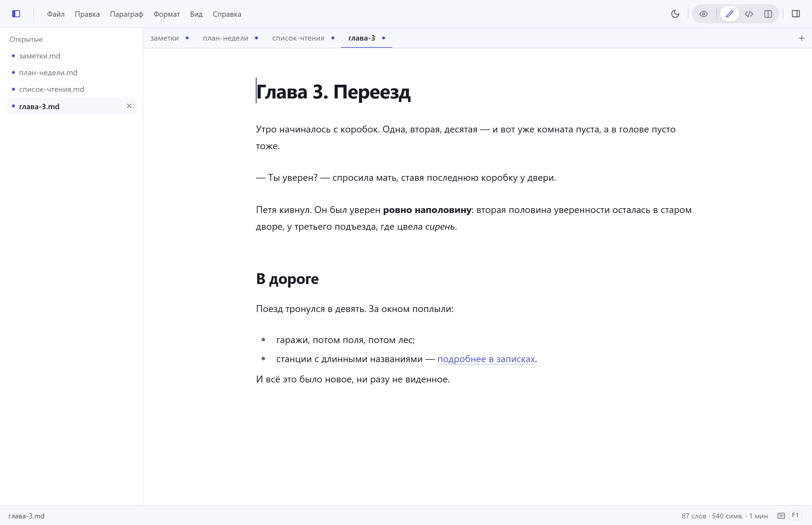
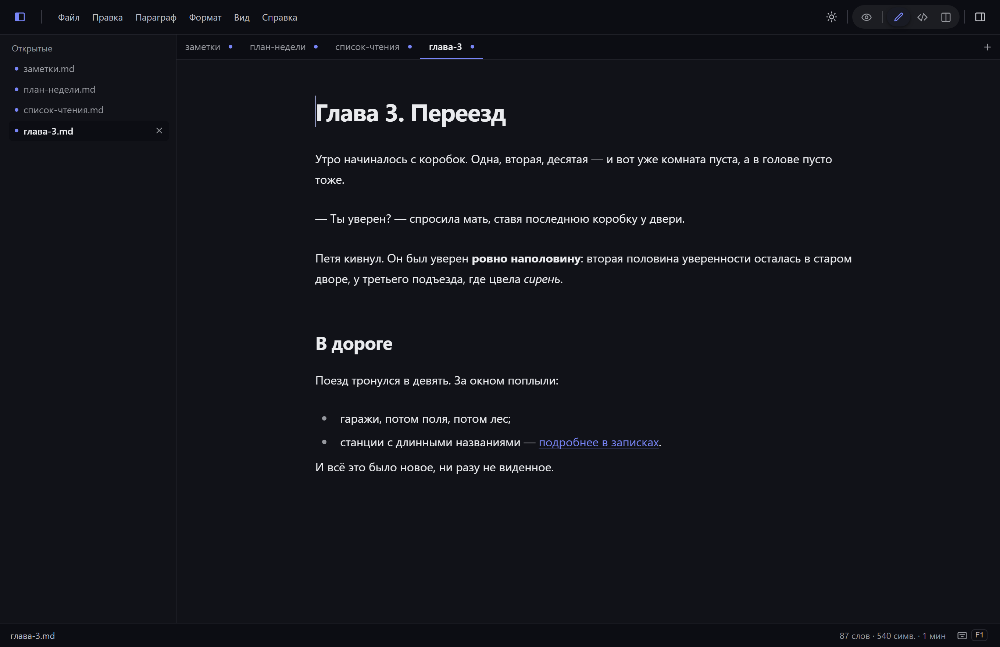

[English](README.md) · **Русский**

<p align="center">
  <picture>
    <source media="(prefers-color-scheme: dark)" srcset="kit/prosamd-horizontal-white.svg">
    
  </picture>
</p>

### Минималистичный открытый редактор и просмотрщик Markdown — «блокнот» для `.md`-файлов.

Открыл файл, читаешь или редактируешь, сохранил. Никаких хранилищ и баз данных — только ваши
`.md`-файлы на диске, сохраняемые побайтово даже из визуального редактора. Лёгкий и быстрый:
Tauri 2 вместо Electron, установщик ~4 МБ, без аккаунтов, облаков и телеметрии.

<p align="center">
  <a href="https://github.com/Wad-man/prosa/actions/workflows/ci.yml"></a>
  <a href="https://github.com/Wad-man/prosa/releases/latest"></a>
  <a href="https://tauri.app"></a>
  <a href="LICENSE"></a>
</p>



Тёмная тема:


**[Скачать последнюю версию](https://github.com/Wad-man/prosa/releases/latest)** · [prosamd.ru](https://prosamd.ru)

Если ProsaMD — ваш тип блокнота, звёздочка репозиторию помогает другим его найти.

## Содержание

- [Чем ProsaMD отличается](#чем-prosamd-отличается)
- [Установка](#установка)
- [Возможности](#возможности)
- [Горячие клавиши](#горячие-клавиши)
- [Сборка из исходников](#сборка-из-исходников)
- [Обновления](#обновления)
- [Архитектура](#архитектура)
- [Дорожная карта](#дорожная-карта)
- [Участие и лицензии](#участие-и-лицензии)

## Чем ProsaMD отличается

- **Как блокнот**: открыл файл → читаешь/редактируешь → сохранил. Никаких хранилищ и баз данных — только ваши `.md`-файлы на диске.
- **Побайтовое сохранение (lossless round-trip)**: открыл → сохранил → файл не изменился. С версии 0.1.10 — и из визуального редактора: front-matter, таблицы и экзотический синтаксис не переписываются.
- **Четыре режима** в одном переключателе (`Alt+1`…`Alt+4`; `Ctrl+/` — Просмотр ↔ редактирование):
  - **Просмотр** — документ как статья: без курсора и правки, ссылки и сноски кликаются обычным кликом, примечания собраны внизу;
  - **Визуальный редактор** — Markdown отображается на лету: весь документ сразу выглядит готовым. Показ исходного синтаксиса блока под курсором (как в Typora) — в планах;
  - **Код** — классический текстовый редактор с подсветкой Markdown и кода в блоках (CodeMirror 6);
  - **Сплит** — код и живое превью бок о бок, прокрутка синхронна.
- **Лёгкий и быстрый**: установщик около 4 МБ, быстрый старт — Tauri 2 вместо Electron.
- **Без аккаунтов и подписок**: никаких регистраций, облаков и телеметрии. Бесплатно и открыто (MIT).


## Установка

Скачать свежую версию — [Releases](https://github.com/Wad-man/prosa/releases) или [prosamd.ru](https://prosamd.ru).

| Платформа | Как |
| --- | --- |
| **Windows** 10/11 x64 | Запустите `ProsaMD_<версия>_x64-setup.exe` (установщик ~4 МБ) или используйте переносной `*-portable-x64.exe` (~8 МБ). Установщик пока без подписи, SmartScreen может предупредить: **Подробнее → Выполнить в любом случае**. |
| **Linux** x64 / ARM64 | Ubuntu/Debian: `sudo apt install ./ProsaMD_*_amd64.deb` (ARM64 — `*_arm64.deb`); ставит иконку в лаунчер и ассоциации `.md`. Прочие дистрибутивы: сделайте `*.AppImage` исполняемым и запустите. |
| **macOS** | Отдельная downstream-версия: [Wad-man/prosa-mac](https://github.com/Wad-man/prosa-mac). |
| **iOS / Android** | Планируется в v0.4. |

## Возможности

- Открытие/сохранение/«сохранить как», перетаскивание `.md`-файла в окно; диалог «Открыть» и Проводник принимают выделение пачкой — каждый файл становится документом в одном окне
- **Полоса вкладок** (v0.3): открытые файлы окна — вкладками под панелью инструментов; нажатие переключает документ, перетаскивание меняет порядок, × закрывает, кнопка «+» и двойное нажатие по пустому месту полосы создают документ; десятки открытых файлов — не проблема: вкладки сжимаются, полоса листается колесом
- **Список открытых файлов** (`Ctrl+Shift+2`): колонка слева со всеми документами окна — переключение, закрытие, «закрыть все» из контекстного меню, ширина меняется перетаскиванием; несохранённые изменения (в том числе несколько изменённых документов сразу) — с подтверждением
- **Недавние файлы**: до десяти в меню «Файл», нажатие открывает
- **Панель меню**: Файл, Правка, Параграф, Формат, Вид, Справка (открывается мышью или `Alt+F/E/P/O/V/H`) — команды форматирования в обоих режимах правки, галочки текущего состояния
- **Оглавление** (`Ctrl+Shift+1` или кнопка в правом верхнем углу): навигация по заголовкам во всех режимах, подсветка активного раздела
- **Поиск и замена** (`Ctrl+F` / `Ctrl+H`) во всех режимах: подсветка совпадений, счётчик, переходы Enter/F3, учёт регистра; в режиме «Код» — панель CodeMirror с регулярными выражениями
- **Печать и PDF** (`Ctrl+P` / `Ctrl+Shift+P`): настоящий диалог печати; «Сохранить в PDF» пишет чистый документ A4 без колонтитулов
- Несколько окон одновременно: каждый файл может жить в своём окне (повторное открытие уже открытого файла фокусирует его окно) — или много документов в одном окне
- Индикатор несохранённых изменений, счётчик слов и символов; при закрытии окна с правками — вопрос о сохранении
- Диалог «О программе» по клику на версию в статусной строке
- Светлая/тёмная тема (по умолчанию — как в системе); интерфейс RU / EN (диалог «Настройки», `Ctrl+,`)
- Сноски в духе Obsidian: нажатие по маркеру — прыжок к примечанию, по номеру — назад; в режиме «Просмотр» примечания собраны внизу
- Выноски Obsidian: `> [!note]`, `> [!warning]`, `> [!tip]` и другие рендерятся с оформлением по типу
- «Копировать для Word» (меню «Правка»): форматирование доживает до Word, Google Docs и почты
- Картинки по относительным путям из папки документа; вставка из буфера сохраняет файл рядом и ставит относительную ссылку
- Проверка и установка обновлений прямо из приложения; автоматическую проверку можно выключить в настройках — выключенная не делает никаких сетевых запросов
- Широкие таблицы и блоки кода выходят в поля окна — без пустоты по краям на широких экранах
- GFM-таблицы, чек-листы, подсветка кода, формулы (KaTeX) — из коробки в визуальном режиме; диаграммы (Mermaid) — в планах плагинов


### Горячие клавиши

| Клавиши | Действие |
|---|---|
| `Ctrl+N` | Новый документ (с проверкой несохранённых правок) |
| `Ctrl+O` | Открыть файл(ы) |
| `Ctrl+S` / `Ctrl+Shift+S` | Сохранить / Сохранить как |
| `Alt+1`…`Alt+4` | Просмотр / Визуальный редактор / Код / Сплит |
| `Ctrl+/` | Просмотр ↔ редактирование |
| `Ctrl+F` / `Ctrl+H` | Поиск / замена |
| `Ctrl+P` / `Ctrl+Shift+P` | Печать / Сохранить в PDF |
| `Ctrl+Shift+1` | Показать/скрыть оглавление |
| `Ctrl+Shift+2` | Показать/скрыть список открытых файлов |
| `Ctrl+,` | Настройки |
| `ПКМ` | Панель форматирования: с выделением — жирный/курсив/код/ссылка, с курсором в блоке — смена типа блока |
| `Ctrl+1`…`Ctrl+6` / `Ctrl+0` | Заголовок 1–6 / обычный текст (то же: `Ctrl+Alt+1…6`, `Ctrl+Alt+0`) |
| `Ctrl+Alt+7` / `Ctrl+Alt+8` | Нумерованный / маркированный список |
| `Ctrl+Alt+C` / `Ctrl+Shift+B` | Код-блок / цитата |
| `Ctrl+B` / `Ctrl+I` / `Ctrl+E` / `Ctrl+K` | Жирный / курсив / инлайн-код / ссылка |

В визуальном режиме также работают markdown-сокращения при вводе: `# ` — заголовок, `- ` — список, `> ` — цитата, ``` — код-блок, `**жирный**`, `*курсив*`; `/` в начале пустой строки открывает меню вставки блоков.

## Сборка из исходников

Требования: [Node.js](https://nodejs.org) 20+, [Rust](https://rustup.rs) (stable, MSVC на Windows), на Windows — VS Build Tools с workload «C++».

```bash
npm install
npm run tauri dev      # запуск в dev-режиме
npm run tauri build    # release-сборка (Windows: exe + NSIS-установщик)
```

Готовые сборки — в [релизах этого репозитория](https://github.com/Wad-man/prosa/releases).

## Обновления

ProsaMD проверяет обновления при запуске (тихо, в фоне); автоматическую проверку можно выключить в настройках. Ручная проверка — в диалоге «О программе» (клик по версии в правом нижнем углу статусной строки).
Установка — скачивание пакета, проверка подписи и перезапуск; права администратора не нужны (установка для текущего пользователя).
У переносной сборки (голый `exe` без установщика) автообновления нет — новую версию нужно скачать вручную.

Релизы и их подписи публикуются в [релизах этого репозитория](https://github.com/Wad-man/prosa/releases)
(до открытия исходников — в отдельном репозитории [Wad-man/prosa-releases](https://github.com/Wad-man/prosa-releases), теперь архивном).

## Архитектура

```
Ядро (TypeScript, общий код для всех платформ)
├─ Визуальный режим — Milkdown (Crepe) на ProseMirror + remark
├─ Кодовый режим    — CodeMirror 6
└─ Нативная оболочка — Tauri 2 (Rust): файлы, диалоги, окна
```

## Дорожная карта

- [x] v0.1.0 — Windows: 2 режима, открытие/сохранение, темы, RU/EN
- [x] v0.1.7 — ПКМ-панель форматирования, локализация Crepe RU/EN, дублирующие сочетания клавиш (как в Typora)
- [x] v0.1.9 — панель меню, оглавление, типографика; буфер обмена и хоткеи в обоих режимах
- [x] v0.1.10 «Lossless core» — побайтовое сохранение из визуального режима (#33), режим «Просмотр» (#66), сноски Obsidian (#64), «Копировать для Word» (#63), картинки с относительными путями (#68)
- [x] v0.2.0 «Эпиграф» — Windows + Linux (x64/ARM64), настройки, печать/PDF, поиск и замена, Raw HTML, масштаб, панель хоткеев, «Что нового»; macOS — отдельной версией в [prosa-mac](https://github.com/Wad-man/prosa-mac)
- [x] v0.3.0 «Разворот» — файлы: несколько документов в одном окне, полоса вкладок и список открытых, недавние файлы, выноски Obsidian, широкие таблицы и код (#11, #97); дерево папки — в v0.4 (#92)
- [ ] v0.4 — плагины и темы от сообщества: платформа API + каталог (#17, #18), дерево папки (#92), iOS / Android (#26)
- [ ] v0.5 — мультиязычность UI, топ-10 языков — через плагин-платформу (#22)
- [ ] Экспорт: печать/PDF — в ядре (готово в v0.2); DOCX/HTML/epub — first-party плагин после платформы плагинов (v0.4)

## Участие и лицензии

Проект открыт по лицензии [MIT](LICENSE). Использует [Tauri](https://tauri.app),
[Milkdown](https://milkdown.dev), [CodeMirror](https://codemirror.net) — спасибо их авторам.
